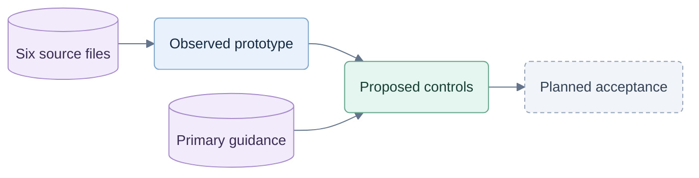

# Security research context

26 September 2026. Target: `C:\repos\test-jev`. Source review and architectural research, not a penetration test, sealed scan or implemented fix. Output is in the owner's requested project directory.

## Evidence identity

No Git revision exists for this project. Historical revision drift is **unknown**. The following six files are the read-only input collection; editable planning documents are design context, not immutable source evidence. SHA-256 collection digest: `951b20c20ca0020622bdc4bdf39793fd75b28204701e01f88bb264dadf6a3d6c`.

Digest recipe: sort paths ordinally; concatenate each path, NUL, lowercase SHA-256, then LF; hash UTF-8 bytes. Source hashes are checked again at handoff. No new runtime tests were executed for this research.

| ID | Inspected input | What it establishes | SHA-256 |
|---|---|---|---|
| E01 | `web/package.json` | React/TypeScript/Vite dependencies | `c8b9e3cf32e549f9d74ea05e15a3ba023cdf620f044d18a77014574f7ed185bf` |
| E02 | `web/vite.config.ts` | Browser build configuration | `b4074503c98cdc1829cd95184adf1296658bf7ca3d451ff6e484d50ce6539c03` |
| E03 | `web/src/App.tsx` | UI imports and executes engine/coach | `0d77f5068b66bb4ea7166a482dddd16949e3dddbd9ad8e87c369de24bdb5b2ad` |
| E04 | `web/src/game.ts` | Full state, deterministic dealing and bot policy | `581a1a34197951a0461226c2cf6ca6942fbb9df47eeaf2dab8281d8e54d7d132` |
| E05 | `web/src/coach.ts` | Local coaching uses game helpers | `f49b418b2ecb7fb8c1df380d30cfe06511b9f456fbba6ac289c00b5ff90ee9ec` |
| E06 | `web/src/storage.ts` | Browser persistence contains game state | `ede5a43e61fdcf9e628c37524bddbb9aaebf06fcc54ba6db627eb7160f27b30a` |

Inspected boundaries: `App.tsx` imports at lines 3–4 and calls to `getAdvice`/`botStep`; `game.ts` `GameState`, `randomSource`, `deal`, `createGame`; `coach.ts` `getAdvice`; `storage.ts` loading/saving through localStorage and IndexedDB. No `web/server` directory exists. This proves a local prototype boundary, not an exploitable deployed billing service.

## Current design context

Observed inputs support proposed controls; hosted verification remains future work.

`planning/06-commercialization.md` owns fixed-demo/member-only play and coached-hand units. `07-hosted-architecture.md` already proposes server authority. `08-commercial-testing.md` owns planned gates; `09-delivery-and-evidence.md` owns rollout. This work refines those documents without changing the game modes, coaching policy, Jev-only provider choice or pricing hypotheses.

## Primary research

Read on 26 September 2026. These sources establish platform behavior; our stack choice and product controls are engineering recommendations, not vendor guarantees.

| Source | Relevant fact |
|---|---|
| [OWASP AJAX](https://cheatsheetseries.owasp.org/cheatsheets/AJAX_Security_Cheat_Sheet.html) | Client logic is modifiable; API services can be called directly. |
| [OWASP authorization](https://cheatsheetseries.owasp.org/cheatsheets/Authorization_Cheat_Sheet.html) | Authorization belongs on each protected request and resource. |
| [Chrome Wasm debugging](https://developer.chrome.com/docs/devtools/wasm), [memory inspection](https://developer.chrome.com/docs/devtools/memory-inspector) | Wasm is inspectable; original-language debugging additionally needs symbols. |
| [MDN workers](https://developer.mozilla.org/en-US/docs/Web/API/Web_Workers_API/Using_web_workers) | Workers change execution context; worker CSP needs attention independently. |
| [MDN key extractability](https://developer.mozilla.org/en-US/docs/Web/API/CryptoKey/extractable), [usages](https://developer.mozilla.org/en-US/docs/Web/API/CryptoKey/usages) | Non-exportable keys can still perform allowed cryptographic operations. |
| [MDN integrity](https://developer.mozilla.org/en-US/docs/Web/Security/Defenses/Subresource_Integrity) | SRI verifies fetched resource integrity, not unmodified-client identity. |
| [IETF browser OAuth](https://www.ietf.org/ietf-ftp/rfc/rfc10017.html#section-6.1) | A backend can hold OAuth tokens; authenticated malicious browser code can still send requests. |
| [Fastify validation](https://fastify.dev/docs/latest/Reference/Validation-and-Serialization/), [server options](https://fastify.dev/docs/latest/Reference/Server/) | Defaults need explicit strict-input, timeout and trusted-proxy configuration. |
| [PostgreSQL isolation](https://www.postgresql.org/docs/current/transaction-iso.html), [locking](https://www.postgresql.org/docs/current/explicit-locking.html) | Concurrency requires actual transactions, locks, constraints and retries. |
| [Stripe webhooks](https://docs.stripe.com/webhooks) | Verify signatures and handle retries, duplicates and unordered events. |
| [Node releases](https://nodejs.org/en/about/previous-releases), [event-loop guidance](https://nodejs.org/en/learn/asynchronous-work/dont-block-the-event-loop) | Use maintained releases and isolate/bound expensive work. |
| [OWASP resource consumption](https://owasp.org/API-Security/editions/2023/en/0xa4-unrestricted-resource-consumption/), [logging](https://cheatsheetseries.owasp.org/cheatsheets/Logging_Cheat_Sheet.html) | Bound resource use and record useful security events without sensitive payloads. |

## Limits

No hosted code, provider configuration, measured capacity or attack reproduction was available. Browser compatibility and detector accuracy remain validation work. The earlier 38-test prototype result is historical evidence in the planning baseline, not a result of this review. A copied interface, public game rules, already-delivered advice, credential lending and external assistance cannot be made impossible by this architecture.

## Artifact verification

Verified eight research files, JSON parsing and option/evidence references, all required tradeoff dimensions, local research links and 45 unique planned acceptance IDs. Recomputed the six-file source collection digest: unchanged. Peer review checked the architecture and demo/access semantics; corrected transport-timeout versus cancellation, saved-content access and family-seat capacity wording. These checks validate the documents, not service security.
