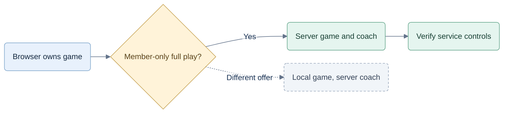

# Security Hardening Review: jev-test

We can keep React/TypeScript and Node. The valuable change is to make the service authorize every protected operation even when the caller understands and replaces the entire browser client.

## Evidence Basis

I inspected the prototype's engine/coach imports, full game state and browser saves. There is no implemented backend. The [evidence inventory](context.md) records six source hashes and primary guidance from OWASP, browser vendors, IETF and framework/database maintainers. This is a design review, not a security certification.

## Constraints

Preserve the game views, Hearts/Spades modes, evidence-based coach and OpenRouter-only Jev integration. [CR-IMPL-004](../decisions/CR-IMPL-004-online-demo-and-launch-readiness.md) updates access preparation: an online authored example and verified game/variant-scoped free/access-trial/paid grants, with separate coaching tools/allowances. Current-game review and purchased/saved permissions remain protected. No production deployment or new product code in this documentation work.

## Opportunity Portfolio

| Opportunity | Evidence | Options | Recommendation | Proposal |
|---|---|---|---|---|
| Protect paid computation and game authority | Browser engine/coach execution and editable full-state saves | 1. Browser engine + protected server coach. 2. Server engine + protected coach + finite demo. | Option 2 under member-only full-play requirements. | [Subscription boundary](proposals/subscription-boundary.md) |

## Recommendation Summary

Observed boundary and proposed choice; the product requirement selects Option 2.

Keep the planned React/TypeScript/Vite browser, supported Node/Fastify service, PostgreSQL and managed identity. The service owns deals, moves, bots, coaching, access and usage. The interface receives only permitted views. We accept a network dependency and operating cost to keep privileged capabilities outside the downloaded app.

Workers, Wasm, hashes and session downloads have legitimate uses, but cannot make executed client code a subscription boundary. Our demo therefore contains only prepared frames and explanations. Repeating or copying it produces no fresh coaching.

The necessary additions to the existing specs are precise route policies, saved-result access, session/job revocation, strict validation, transaction initialization and measured abuse controls. Detection complements enforcement; it does not establish an unmodified browser.

## Next Decisions

Follow the [proposed implementation plan](implementation/server-authority.md) through local then hosted gates. Identity/hosting vendors, exact supported browser versions and measured capacity remain rollout choices. No language rewrite or browser DRM layer is recommended.

[Structured analysis](hardening.json) contains evidence coverage and unmeasured tradeoffs. The architecture and acceptance suite remain proposed; no hosted protection has been implemented or tested here. Subsequent capacity requirements are recorded in `planning/10-capacity-and-scaling.md`.
