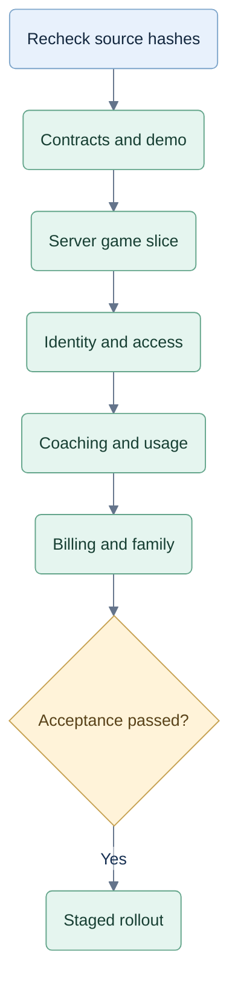

# Implementation Plan: server authority

## Selected Design And Constraints

Proposed handoff for the recommended Option 2; no implementation is performed by this document. Preserve React/TypeScript/Vite and use supported Node/Fastify, PostgreSQL, managed identity and server-only OpenRouter credentials. The finite demo is public; new live games/coaching require the applicable subscription. The owner requested planning before development.

## Source Revision And Drift Check

Input collection SHA-256: `951b20c20ca0020622bdc4bdf39793fd75b28204701e01f88bb264dadf6a3d6c`. Exact file hashes and limitations are in [context](../context.md). No Git revision is available. Before coding, rehash those six files and reread current planning 06–09. Investigate boundary changes before applying this handoff; do not overwrite intervening work.

## Affected Components

Existing `web/src/App.tsx`, `game.ts`, `coach.ts`, `storage.ts` and build configuration. Planned modules: `web/server/{game,strategy,coaching,access,billing,records,http}`, public DTOs in `web/shared`, finite content in `web/public/demo`. No new general-purpose browser evaluator.

## Ordered Work Packages

Proposed sequence; delivery and detection controls apply throughout.

| Package | Concrete deliverable | Acceptance/dependency |
|---|---|---|
| Contracts and demo | Public seat/command DTOs; operation-policy matrix; bounded authored demo graph with choice, cue, explanation and replay. | All branches work; no live/provider requests; T01–T03. |
| Authoritative game slice | Server CSPRNG deal, legal commands, bots, journal and safe seat/replay views; browser renders confirmed revisions. | Hidden data excluded; races/idempotency hold; T04–T05, T09, T30–T32. First package complete. |
| Identity and access | Managed-login adapter; opaque cookie sessions/CSRF; ownership, grants, control leases, session/access generations; default-deny route registration. | Two-player/family access matrix and warm-cache revocation; T06–T10, T36, T43–T44. |
| Coaching and durable usage | Player lock, unique hand unlock, allowance reservation, bounded workers, lease/fencing, cancellation, saved-result recovery. | Real PostgreSQL first-use/last-unit races; no duplicate charge; T11–T17, T26–T29. Requires server records and identity. |
| Billing and family | Server-created purchases, provider-bound beneficiaries, verified inbox/reconciliation, seat capacity/history and effective revocation. | Sandbox lifecycle and family races; T18–T25. No live billing before commercial approval gates. |
| Delivery and detection | Private result delivery, strict schema/proxy limits, shared budgets, artifact checks, bounded security events and detector observation mode. | T03, T33, T37–T45; documented recovery and false-positive handling. Apply baseline controls throughout earlier packages. |

Use existing strategy/candidate-generation plans inside the server boundary. Shared bot/coach policy, Jev off/shadow/recommend and assistance accounting keep their existing meaning. Provider calls never sit inside retried database transactions.

## Compatibility And Migration

Keep the current table, cue hierarchy and accessible controls. Convert browser saves to local-reference-only material; never import them as trusted games, quota or progress. Declare exact supported browser/device versions after testing maintained releases. A future app wrapper uses the same service rules.

Distinguish transport timeout, job expiration and access revocation. A valid job may finish after a disconnected request and be recovered once; a canceled/expired/fenced job cannot publish. Plan expiry permits owned saved content but prevents new work. Security session revocation prevents use of that session and fences its unfinished work.

## Tactical Protections During Migration

Keep the old prototype local and prevent its publication through legacy routes or chunks. Development grants are explicit and rejected by hosted configuration. Keep provider keys server-only, schemas strict, result views allowlisted and private APIs outside CDN/service-worker caches from the first slice. Do not temporarily trust client plan/state flags.

## Tests And Security Validation

Implement the planned cases in `planning/08-commercial-testing.md` against the actual components. Use a direct HTTP client with full protocol knowledge; never count a hidden button as a security check. Test two owners, unpaid/expired/revoked accounts, family-payer limits, copied IDs, unknown routes, caches, conditional reads, late workers and billing disorder. Failure evidence must include redacted responses and durable records.

G1 is the local server slice; G2 uses real authentication/PostgreSQL without customer charges; G3 adds payment/cost/country gates. Future PvP remains separate. No security test is marked passed by this plan.

## Performance And Resource Benchmarks

Use T37's declared workload sweep and report hardware, database/runtime versions, p50/p95/p99 latency, event-loop delay, peak API/worker memory, queue wait, cost per hand and errors. Compare the current local interaction baseline with server confirmation under normal/mobile latency and bursts.

Pilot targets remain non-analysis API p95 below 300 ms in-region and visible code advice p95 below one second at the declared budget. Queue/memory limits must prevent resource exhaustion at admitted load. If targets or plan economics fail, resize, reduce admitted work or revise the offer; do not ship privileged browser fallback code. Wasm or a worker-language rewrite requires a profile demonstrating the bottleneck and a benchmarked improvement.

## Rollout And Rollback

Progress from local mocks to isolated staging, invited non-paying pilot, then commercial gates. Start behavioral detectors in observation mode; enforcement thresholds need legitimate-use evidence and a recovery path. Keep provider kill switches, compatible schema migrations, backup recovery and access-denial metrics.

Rollback to a compatible secure service version. If safety cannot be maintained, pause new work and preserve confirmed state. Never roll back to client-owned paid authority or stale positive grants.

## Acceptance Criteria

The official browser may be modified and the API fully understood without granting unauthorized service work. Public artifacts contain no full-game/evaluator capability. Owned saved results recover without duplicate consumption. Required accounting is atomic. Negative tests, failure recovery, latency/cost evidence and detector false-positive review pass their gates.

## Open Decisions

Identity/hosting vendor and region; exact browser matrix; measured worker/concurrency budgets; final prices/currency and fair-use terms. These choices refine deployment, not the fundamental access boundary.
