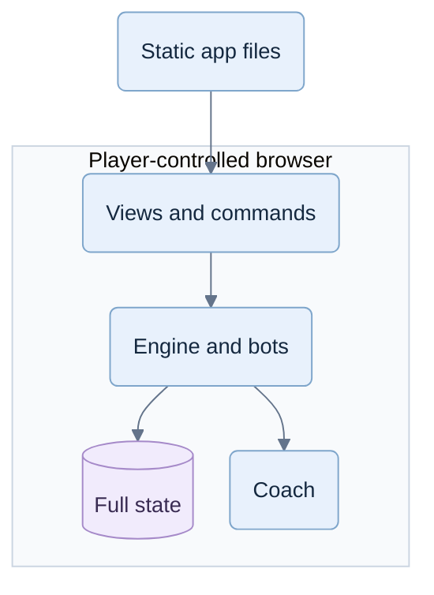
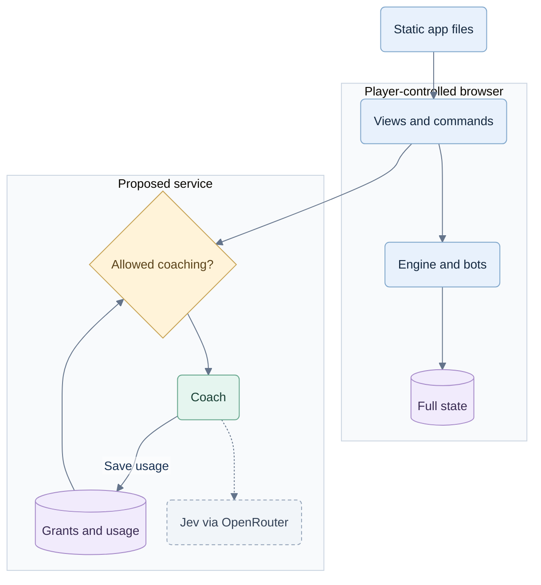
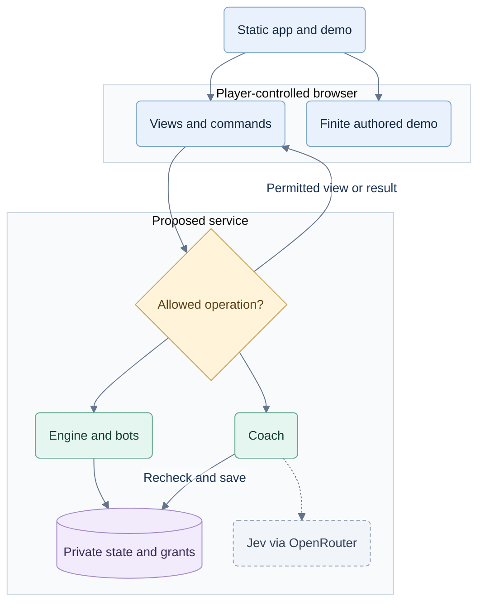

# Security Hardening Proposal: subscription boundary

## Decision

Keep the TypeScript stack and move all valuable live game/coach execution to the service. We should design for a known API and an untrusted browser, rather than depend on concealing how the interface works.

## Executive Recommendation

We considered **Option 1: browser engine with a protected server coach** and **Option 2: server engine and coach with a finite public demo**. I recommend Option 2 because full games now require membership. Option 1 would fit a product that intentionally offered unrestricted local play.

## Evidence

I inspected the actual prototype. Its browser runs the rules and coaching and stores all hands. Those are useful local-development choices; we cannot turn them into paid-access enforcement by adding a hidden interface check.

| Evidence | Source | Observed fact |
|---|---|---|
| E01 — Dependencies | `web/package.json` | Existing React, TypeScript and Vite project. |
| E02 — Browser build | `web/vite.config.ts` | Browser build targeting ES2020; no security boundary. |
| E03 — UI execution | `web/src/App.tsx` | Imports engine/coach and calls advice/bot operations locally. |
| E04 — Full game aggregate | `web/src/game.ts` | Full hands, seeded deal and game transitions exist in browser-imported code. |
| E05 — Local advice | `web/src/coach.ts` | Coaching calls local strategy helpers. |
| E06 — Browser saves | `web/src/storage.ts` | Game state persists in player-controlled storage. |

The [hash inventory](../context.md) identifies these inputs. **Inference:** retaining executable full-game capability in the client would let a modified copy continue local play after a UI gate expires. **Proposed:** remove that capability from public artifacts and authorize service operations. We did not observe an existing deployed subscription bypass; billing is not implemented.

## Current Design And Failure Mode

The relevant actor controls their browser, storage and requests. Minification can inconvenience inspection, but changing a local subscription boolean or replaying an API request is not something we can forbid at that endpoint. We must instead decide which operations our service will honor. This follows [OWASP's client/server guidance](https://cheatsheetseries.owasp.org/cheatsheets/AJAX_Security_Cheat_Sheet.html).

The latest hosted architecture already chooses this boundary. The remaining design risk is inconsistent enforcement: a guarded button or POST can coexist with an unguarded cached answer, background job or billing transition.

## Desired Invariants

- A visitor can replay prepared content but cannot obtain new service play, advice or analysis.
- Each accepted action has an authenticated owner, applicable access, legal state and durable record.
- New coaching requires current coverage and an atomic hand unlock; retries never multiply allowance.
- Revoked authority cannot authorize later work/publication. Saved-result reads follow their own ownership policy.
- Only the player's permitted observation reaches the client or strategic evaluator.
- Knowing the protocol or suppressing optional analytics never changes these rules.

## Constraints And Non-Goals

We preserve concise coaching, all three modes, current-game replay, individual/family plans and Jev through OpenRouter. We use the existing balanced latency/cost targets, not invented benchmark claims. Browser-only offline full play, secrecy of downloaded content, perfect credential-sharing detection and preventing external AI assistance are outside this promise.

## Before Architecture

This view shows the inspected local prototype. There is no subscription server to attack yet.

The full aggregate and execution capability share the player's trust boundary. [Diagram source](../diagrams/subscription-boundary-before.mmd).

## Options

### Option 1: Browser engine with a protected server coach

We could keep the engine and bots locally and move only coaching, Jev credentials and allowance checks to a service. This preserves fast/offline ordinary play and reduces game-server traffic. A well-authorized coach API could still prevent unpaid provider use.

However, the engine remains downloadable. Wasm or an expiring delivery key cannot stop an already-received copy from executing. Browser saves also cannot establish trustworthy hosted outcomes; the service would need separate authoritative records if we later added competition. This option protects a remote coach, but intentionally concedes unrestricted local gameplay.

Resource cost moves mainly to the user's device. We would operate identity, billing and coaching anyway, while maintaining two state boundaries. Migration is smaller than moving all rules, but it would require changing the current paid-full-play promise. Rollback could disable coaching and retain local play only if that product decision were accepted.

Compared with the before view, the coach crosses a real boundary while the engine remains inspectable and reusable. [Diagram source](../diagrams/subscription-boundary-browser-engine-after.mmd).

| Change | Before | After | Security consequence | Cost |
|---|---|---|---|---|
| Coach | Local executable | Authorized service | Protects new remote coaching | Network, identity and quota service |
| Engine/state | Browser-owned | Browser-owned | Local full-play capability remains copyable | Low server game cost; untrusted outcomes |

### Option 2: Server engine and coach with finite demo

We retain React for presentation and move rules, bots, dealing, strategy and coaching into server-only modules. Shared code contains public contracts and display utilities. A small public demo player advances only through authored frames; it cannot evaluate arbitrary positions. Clearing cookies repeats the same example.

The API resolves identity, ownership and the exact operation's policy before accessing results or accepting work. A valid login is insufficient; a family payer does not own members' games. Live play needs active coverage. New coaching needs coverage plus an unlock. Previously saved coaching remains readable by its owner after plan expiry within current-game scope. This distinction avoids accidentally charging for factual replay or revoking already-delivered learning material.

We keep short transactions around grants, game revisions, reservations and journal entries. Workers reconstruct observations from server records, use bounded leases, and recheck authority before dispatch and publication. Provider calls stay outside transactions. Current access/session generations prevent a warm replica cache from resurrecting revoked authority; fencing rejects late workers. Cached results and polling still authorize. [OWASP authorization](https://cheatsheetseries.owasp.org/cheatsheets/Authorization_Cheat_Sheet.html) supports checking each request; our operation matrix supplies the product-specific rules.

This costs network round trips, database writes and server CPU/memory for every game. We isolate expensive analysis from the API event loop, bound queues and keep animations local while waiting for confirmation. An outage pauses new live work; it must never unlock an offline fallback engine. Capacity, tail latency and provider costs need measurements before commercial promises.

We can introduce this as a vertical slice with local mock grants, then real identity/PostgreSQL, then sandbox billing. We retain the old prototype only for local reference. Rollback means a previous compatible secure service or a pause with saved state—not republishing the old browser engine.

The client now holds a permitted view; only the service can produce fresh authoritative play or coaching. [Diagram source](../diagrams/subscription-boundary-server-authority-after.mmd).

| Change | Before | After | Security consequence | Cost |
|---|---|---|---|---|
| Engine/coach | Downloaded executable | Server-only modules | UI edits cannot create service authority | Migration, compute and latency |
| Full state | Browser saves | Private database and seat views | Concealed cards stay off the client | Projection/recovery work |
| Trial | Full local capability | Finite authored frames | Resets expose no new capabilities | Demo authoring |
| Access | No paid boundary | Per-operation policy and atomic records | Direct calls face the same checks | Auth, billing and concurrency tests |

### Browser mechanisms considered

These are supporting techniques, not additional architectures.

| Idea | Appropriate use | Subscription limit |
|---|---|---|
| Minification/private source maps | Smaller downloads, less accidental source exposure | Client behavior remains inspectable. |
| Web Worker | Responsive rendering/computation | Separate thread is still on the player's device. [MDN](https://developer.mozilla.org/en-US/docs/Web/API/Web_Workers_API/Using_web_workers) |
| Wasm | Profile-proven CPU optimization | Binary/memory can be inspected; exact original source requires suitable symbols. [Chrome](https://developer.chrome.com/docs/devtools/wasm) |
| Session-only/encrypted bundle | Restrict initial delivery | Expiry cannot recall usable code already downloaded. |
| Hash/signature | Integrity and server-verifiable assertions | Does not prove the sender used an unmodified UI. [SRI](https://developer.mozilla.org/en-US/docs/Web/Security/Defenses/Subresource_Integrity) |
| Non-extractable key | Restrict key export | Allowed signing/decryption remains possible; plaintext outputs are visible. [Extractability](https://developer.mozilla.org/en-US/docs/Web/API/CryptoKey/extractable), [usages](https://developer.mozilla.org/en-US/docs/Web/API/CryptoKey/usages) |

A same-origin backend session keeps provider tokens away from browser JavaScript. It still needs CSRF/XSS protections and server authorization: malicious authenticated browser code may issue requests through the session. [IETF browser OAuth](https://www.ietf.org/ietf-ftp/rfc/rfc10017.html#section-6.1). Short-lived scoped links may be useful for future downloads; they do not justify a custom per-click cryptographic handshake here.

## Comparison

We compare expected effects against the current local prototype. None is a measured performance result.

| Dimension | Option 1 | Option 2 | Confidence/basis and validation |
|---|---|---|---|
| Security | Protects remote coaching; reusable game remains | Protects all service work if policies hold | High, source-derived; direct-call and artifact tests |
| Performance | Local game path preserved | Adds API/database round trips | Medium, hypothetical; T37 latency/load sweep |
| Memory/resources | Client game memory plus coach service | Server tables, workers and queues increase cost | Medium, hypothetical; peak memory/queue depth per workload |
| Reliability | Local play survives service loss | Live play depends on service; durable recovery | High boundary fact, availability unmeasured; T13/T38 |
| Operations | Coach/auth/billing service required | Adds game records, scheduling and recovery | Medium, source-derived; failure and backup exercises |
| Migration | Smaller extraction, but changes paid promise | Larger extraction; preserves intended commercial scope | High, source-derived; vertical slice plus bundle checks |
| Developer ergonomics | Two authorities risk divergence | One domain authority; strict public contracts needed | Medium, inferred; import and route-policy checks |
| Rollback | Disable coach; unrestricted local play remains | Compatible service rollback or pause | High, design-derived; staged rollback rehearsal |

A Go, Rust or .NET backend could implement the same boundary. None removes our ownership, billing or concurrency responsibilities. We have no measured workload or team constraint supporting a rewrite; TypeScript reuse is the smaller migration. Use a supported Node release and isolate CPU work as described by [Node](https://nodejs.org/en/learn/asynchronous-work/dont-block-the-event-loop).

## Recommendation

I recommend Option 2 with Node/Fastify/PostgreSQL. The existing plan already points there; we should refine and verify it, not add browser DRM. Option 1 becomes preferable only if unrestricted local play becomes intentional and authoritative hosted outcomes are unnecessary.

The demo should present one meaningful choice, an optional cue, a restrained explanation and original/scripted-alternative replay, then “Play new hands with coaching.” It must feel like the paid coach without containing a general evaluator. Demo progress is never a real skill assessment.

## Evidence Coverage And Residual Risk

| Evidence | Option 1 | Option 2 | Required during migration |
|---|---|---|---|
| E01 dependencies / E02 build | Unaffected foundation | Unaffected foundation | Supported versions; inspect output, not just source imports |
| E03 UI execution | Mitigates coaching exposure | Addresses privileged client execution | Remove legacy/lazy-route capability before public launch |
| E04 full aggregate | Unaffected engine exposure | Addresses aggregate delivery | Allowlist views; never trust old saves |
| E05 local advice | Addresses remote-coach capability if fully removed | Addresses local paid-advice capability | No evaluator in demo/shared/browser code |
| E06 browser saves | Unaffected local authority | Addresses authoritative save trust | Recover only server-owned state |

“Addresses” describes proposed coverage, not a verified fix. Both options retain credential theft, authorized automation, output copying, provider failures and implementation bugs. Neither can prevent independent recreation of public rules.

Detection should observe denied ownership/access, conflicting retries, work volume and provider spend. Invalid operations are rejected regardless of detector confidence. Behavioral rules begin in observation mode, then use proportionate throttling/reauthentication/review with measured false positives and recovery. We cannot reliably detect someone merely inspecting their own browser, and do not need to.

## Migration And Rollout

Keep the prototype local; ship no general engine on a public demo route. Implement the authoritative vertical slice, verify real identity/storage, calibrate detectors, then activate billing only after the commercial gates. Preserve the last confirmed table on failure. Never relax authorization as an availability fallback.

## Validation Plan

Use the planned cases in `planning/08-commercial-testing.md`, especially known-protocol direct requests, finite-demo graph coverage, artifact inspection, two-owner access, first-use/last-unit races, revocation during work, cached reads, billing reconciliation and abuse bursts. Include physical target devices and accessible input. Subsequent capacity tiers are specified in `planning/10-capacity-and-scaling.md`. No hosted test has run for this proposal.

## Implementation Work Packages

The [implementation handoff](../implementation/server-authority.md) orders contract/extraction, authorization, atomic coaching, billing and detection work with acceptance gates. Our measurable exit condition is denial of unauthorized service capability, not secrecy of the client.

## Open Questions

Choose identity/hosting vendors and exact supported browser versions through the pilot. Measure sustainable concurrency/cost and detector false positives. Final pricing, currency and fair-use terms stay open product decisions; they do not change the enforcement boundary.
