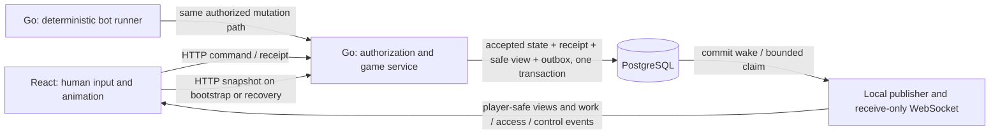

# Local realtime acceptance

Implements [CR-ARCH-005 / RT-01–RT-10](../../planning/decisions/CR-ARCH-005-local-realtime-and-server-bots.md). Scope: the native Go/PostgreSQL application on loopback, with the built React client or the watched Vite proxy.



Go previously selected and committed bot actions, but React initiated preparation and advancement after presentation delays. Go now owns that progression. The player controls real server pause/resume; the browser's animation timer does not delay commits. Human choices and explicit round/chance continuation retain their HTTP path.

Browser storage stays scoped: tab control leases use sessionStorage; unresolved HTTP intents use localStorage without embedding lease secrets. Realtime cursors, binding IDs and views remain in memory. A 401 invalidates mounted private state and pending late responses. The socket carries no browser mutations or secret lease credentials.

## Verification

- Focused Go realtime, HTTP and record checks passed sequentially: HTTP 0.587s, service 11.812s, records 7.362s. Tests cover all seven installed bot modes, human/sealed boundaries, pause fences, restart, atomic exact-revision outbox views, cursor order/retry/gaps, bounded retention, erasure, receive-only sockets and logout closure.
- Browser transport/recovery and pending-command tests: 23 passed, zero skipped. Coverage includes authentication races, original playback-receipt recovery, snapshot/frame ordering, control invalidation during a snapshot, failed initial handshakes and shutdown during negotiation.
- Race-enabled realtime checks passed for records (10.262s), HTTP (1.698s) and service (28.872s). Current policy compatibility, legacy projection upgrade, missing-runner pause and original playback receipts are covered. A combined run encountered local PostgreSQL fixture timeouts; the service checks passed on their isolated rerun.
- Existing `TestM04EPlatformCatalogPresentationAndRecovery` passed (2.032s). This check exposed a stale account availability limit of three after the catalog grew to seven; both account modes now permit the installed seven, with acceptance and overflow contract fixtures.
- Generated contracts are current: 197 definitions, 459 Ajv fixtures and nine RNG vectors. Web typecheck and production build passed. The browser source boundary passed for 51 reachable modules, with no forbidden server identifiers or source maps. The build still emits its bundle-size advisory.
- Final real-browser run: **2 passed in 15.9s**, zero failed/skipped/flaky and no test retries (9 October 2026, 22:14 Toronto). Spades (7.9s) covers pushed bot revisions, human input, real server pause, socket reconnect and paused reload. Trix (6.5s) covers switching games, request selection, a human card followed by pushed bot revisions and pause. Both assert that the browser sends no `/api/session/advance` commands and raises no page errors. The complete build/server/test watchdog passed in 30.6s.

Earlier browser runs exposed and resolved bootstrap recovery and game-switching races. The test setup also needed to account for randomized human-first turns, presentation catching up to server state, and bounded 429 snapshot recovery during bot commits. One run had an empty page before any API request; another observed a server runner pause after completed preparation, with no bot move committed. Local PostgreSQL connection/setup timeouts were independently observed, but the exact cause of that individual runner pause was not captured. A focused read-only audit found no nested pool acquisition or transaction self-deadlock in the new paths. This intermittent local timeout/startup behavior remains an operational observation, not a passing reliability or load claim.

Reproducible focused commands (native PostgreSQL must be running):

```powershell
node scripts/windows-env.mjs go test -p 1 -race ./server/internal/records ./server/internal/http ./server/internal/service -run 'TestRealtime|TestLocalTransport' -count=1 -timeout=120s
node scripts/windows-env.mjs go test -p 1 ./server/internal/service -run '^TestM04EPlatformCatalogPresentationAndRecovery$' -count=1 -timeout=90s
node --test --test-isolation=none web/tests/client-recovery.test.ts web/tests/go-pending.test.ts web/tests/realtime-stream.test.ts
npm run contracts:check
node scripts/windows-env.mjs node scripts/m02a-contracts.mjs --check
npm run typecheck --workspace web
node web/scripts/check-artifacts.mjs --source
node scripts/bounded-native-run.mjs --seconds=180 -- node scripts/windows-env.mjs node scripts/realtime-browser.mjs
```

The real-browser lane builds Go and the Go-targeted React bundle, starts its own temporary loopback listener using the isolated test database, and closes that listener on exit. It requires both scenarios to pass without retries or skips. Its report is `.local/realtime-acceptance/browser-report.json`; failure traces are under `test-results/realtime`.

RT-09 startup follow-up: `npm run pg:start` passed against the existing local cluster. `npm run start:go` detected the existing Vite listener on port 4174 before building, without stopping it. The updated startup script then passed all five stages on a temporary port with the isolated test database: Go build, TypeScript, Vite, health HTTP 200 and frontend HTTP 200 (15.9s whole smoke check). The temporary process was stopped afterward. The original development listener was left running; it must be stopped in its original terminal before starting the updated app on 4174. Normal startup no longer nests npm build wrappers, and its progress explicitly identifies the otherwise quiet TypeScript stage.

RT-07/RT-09 saved-table Resume follow-up (9 October 2026, 22:46 Toronto): reproduced a saved Trix Complex Partners table with no control lease in the current tab. Resume failed while both the error and **Take control** action were inside the inert table behind the pause dialog. Both table interfaces now expose **Take control** and recovery errors within that dialog, prevent duplicate recovery clicks, and keep claiming control separate from Resume. Closing a view-only dialog does not claim control.

The existing two browser scenarios now also open a second tab, verify explicit control recovery preserves the same game ID and revision while paused, then confirm Resume starts server playback. Web typecheck and production build passed. The complete browser rerun passed **2/2 in 23.3s** with zero skips/retries and no page errors; the whole build/server/test watchdog passed in 45.5s. An earlier attempt passed Spades but failed before the Trix page loaded with `net::ERR_EMPTY_RESPONSE`; the rerun does not establish the cause of that transient failure.

The stale development stack was replaced with the current built Go application on 4174. Because Go reads the built frontend into memory at startup, it was restarted after the dialog fix. In the user's existing browser tab, **Take control → Resume game** then succeeded: the saved Trix layout and hand were preserved, the pause dialog closed, and legal human cards became enabled. No human card was played during this verification.

## Operational boundaries

The local channel runs inside the existing Go process. Admission is bounded at 256 bindings overall, four per owner and twelve negotiations per owner per minute. At most eighteen server playback runners are admitted, matching the existing local work capacity. Frames are limited to 2 MiB; each server connection has at most 64 queued frames and 4 MiB queued bytes. Idle connections are checked every fifteen seconds with a five-second deadline. HTTP and socket writes remain bounded. Slow consumers close and recover through HTTP.

Commits signal the publisher immediately. A one-second publisher safety check covers restart or a missed wake; it is not the ordinary update path. Exact committed safe projections retain intermediate bot frames. Retention is bounded to 512 events per owner and periodic expiry; it is a delivery buffer, not a second game-history archive. Cloud routing, shared publisher coordination and capacity need separate measurement.

`CARDFORD_REALTIME=off` keeps HTTP recovery. Server restart invalidates the prior playback instance, requiring a fresh authenticated Resume. A bot runner also pauses on a preparation, authorization or bounded database failure; recovery requires an explicit Resume after the underlying problem clears. Migration 011 adds derived projections, stream cursors, bounded outbox entries and playback fences, with account-erasure cleanup.

No cloud resources were provisioned. Hosted authentication, HTTPS/WSS, managed provider integration, production quotas/abuse controls and measured 100K concurrent users remain rollout gates. Local tests do not establish that capacity.
