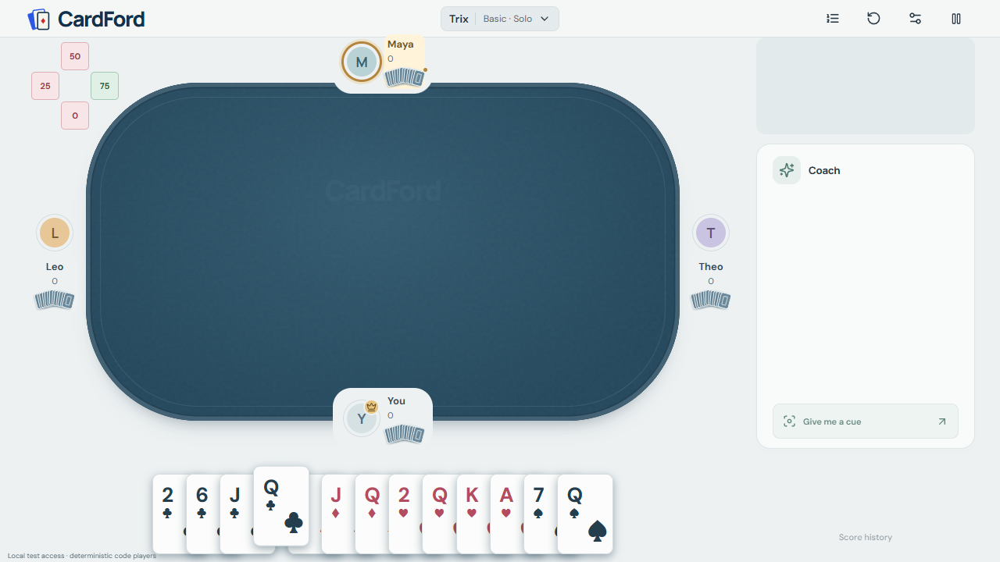

# UX-45 — live card gesture diagnosis, 9 October 2026

The owner confirmed the inspected preview was their live table and identified the last played 3 of hearts as the failed interaction. The [saved browser-console trace](shared-table/live-gesture-before.json) captures that exact input sequence. This is a live input trace, not a full Chrome CPU profile or backend trick-history export.

## Observed failure

- The first H3 press reached its hold callback after **213.1 ms**. The player released roughly 10 ms later without dragging.
- The hold path suppressed that first click and cleared the click-pair state. The next browser click had `detail: 2`, but no first click remained, so no activation or server submission occurred.
- A later retry with approximately **180 ms between clicks** activated immediately. The delay was in local gesture recognition, not a backend response.

Two additional next-turn failures were reproduced in isolated browser fixtures: a bot decision between clicks erased the first click; bot server work disabled the human hand, preventing the second click. A fourth fixture showed that moving 14 px before pickup canceled the 200 ms timer entirely.

## Changes

The shared hook now preserves click pairing across opponent decisions in the same deal. Local off-turn selection remains enabled during opponent server work, while pause/access/error gates and human submissions stay protected. A stationary hold can still be the first half of a double-click or double-tap; an actual drag consumes its click. Small pre-hold movement is tolerated, with the timer still fixed at 200 ms. Existing legal-turn-only dragging, drag bounds, near-hand return, queue cancellation and server legality checks remain.

Temporary tracing was removed after capture. The first instrumentation hot update added a hook and triggered a React hook-order error; removing that additional hook and reloading restored the saved table. Subsequent fixes preserved hook order. No human card, request choice or game reset was submitted by the agent. The owner played the observed cards. The temporary landscape override was reset; the preview remains open at port 4174 with its watched frontend.

## Verification

All four reproduced failures first failed targeted checks. The captured stationary-hold sequence passed after the fix, as did its Chrome DevTools Protocol touch-input equivalent.

Final cross-game command:

```powershell
node scripts/bounded-native-run.mjs --seconds=120 -- node scripts/windows-env.mjs node node_modules/@playwright/test/cli.js test --config web/e2e/playwright.config.ts web/e2e/table.spec.ts web/e2e/trix-ui.spec.ts --grep "long hold|spanning bot decisions|bot preparation does not|small movement during|first stationary press|touch double-tap still|off-turn|queued cards|double-tap plays|responds immediately|touch hold|resize cancels|rejected pending|compact doubling" --reporter=line --trace=retain-on-failure
```

Result: **28 passed, 1 failed before table setup**, 98.1 seconds including wrapper. The failed case timed out waiting for the initial Resume button; it did not reach a gesture assertion. A bounded 60-second rerun with grep `off-turn queued card|spanning bot decisions|first stationary press|touch double-tap still` passed **4/4**, 12.1 seconds including wrapper, after temporary logging was removed. Thus all 29 distinct selected checks have passing evidence, but the combined campaign was not an uninterrupted pass. The off-turn visual was refreshed by rerunning `spanning bot decisions` after advancing its presentation clock; **1/1 passed**.

Production TypeScript (`-p web/tsconfig.json --noEmit`) and browser-fixture TypeScript (`-p web/e2e/tsconfig.trix-ui.json --noEmit`) passed with the bounded runner. Existing shared Hearts/Spades and every Trix variant's trick/Jacks drag checks passed, along with doubling, pending-server feedback, rejection, touch, pause and queue checks. This is local UI evidence, not physical-device or hosted acceptance. Runtime uses deterministic code players; no provider was activated.


