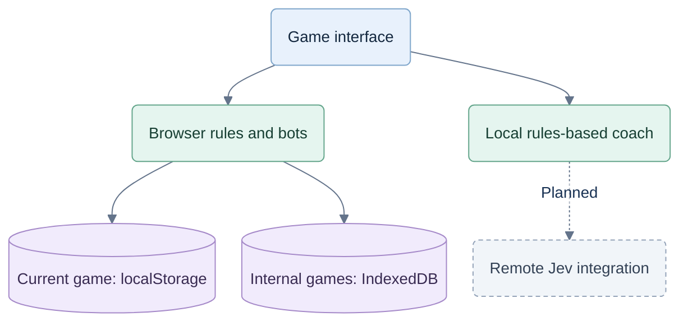

# CardFord web application

**Current runtime:** React/Vite uses the TypeScript server-authoritative engine and PostgreSQL. Run commands from `C:\repos\test-jev`; see [local setup/start instructions](../LOCAL-README.md) and [selected-deal training](../planning/dev-deals.md). Identity/billing are local fixtures and Jev is off. [M02](../qa/implementation/multi-game/m02/status.md) completed game-owned TypeScript extraction; V2 persistence and service/client activation remain unfinished.

**Next backend direction:** [CR-ARCH-003](../planning/decisions/CR-ARCH-003-backend-stack-and-system-readiness.md) prefers Go/PostgreSQL, with the current TypeScript service retained as the reference. [M02A](../planning/implementation/multi-game/backend-readiness.md) first freezes contracts and proves one bounded compatibility slice. Preserve this React/Vite UI and assets. This review starts no port; hosting, native packaging and advanced operational work remain later gates.

A playable UX build for a card-game coach. The table comes first; help stays optional.

The owner selected **CardFord** on 28 September 2026. The earlier `trickscoach.com` domain plan remains unverified; no CardFord domain has been selected. See the [brand decision](../planning/brand-and-domain.md).

## Run the current application

```powershell
cd C:\repos\test-jev
npm run build
npm start
```

After completing the database/dependency setup in [LOCAL-README](../LOCAL-README.md), open `http://127.0.0.1:4173`. `npm run dev` runs the API on 4173 and Vite on 5173 with an API proxy; stop an existing app first to avoid port conflicts. Current local services bind to loopback. Physical-device access and hosted startup require their own environment work.

```powershell
npm run contracts:check
npm run typecheck
```

See the local guide and [M02 evidence](../qa/implementation/multi-game/m02/status.md) for scoped verification commands and test-database requirements. Existing Node checks remain TypeScript regression/oracle checks; they cannot alone accept a replacement Go path.

## Included

- Hearts solo, Spades solo and Spades partnerships: complete hands, scoring, successive hands and match outcomes.
- Passing and bidding with confirmation. Double-click/tap prepares a card off-turn and plays it on your turn; prepared cards never auto-play. Space selects and Enter plays for keyboard use.
- Three optional help levels: cue, context, suggestion. Coach preferences: when asked, occasional contextual nudges, after the hand.
- Public card counts, revealed voids and last-trick recall. No player-facing game archive.
- Hand recap with score and actual help usage; no invented accuracy, skill rating or mistake labels.
- Pause, automatic pause in background/portrait, current-game recovery, keyboard dialogs and reduced motion.
- Persistent game speed in Settings: 1×, 1.2× or 1.4×. Faster settings shorten bot/trick waits, not coach reading time.

## Screen behavior

iPad supports both orientations. Viewports under 700 CSS pixels wide that are taller than wide show a landscape gate; the game pauses until rotated. The app never rotates the page with CSS or assumes iOS will allow an orientation lock.

Landscape phones reserve the full screen width for the hand. Cards retain at least 44 pixels of exposed horizontal tap area at the tested 667-pixel minimum width. Insets protect notches and home indicators; visual viewport sizing follows browser chrome. Shorter screens can scroll the coach explanation while keeping its action available.

Support targets 2020-or-newer phones running maintained browsers. Physical iOS/Android device validation remains necessary; emulator viewport checks are not hardware certification.

## Current boundary

The games and code coach work without an API key. Server-side sampled review continuations and strategy/evaluation code exist; they do not establish strategy strength or learning benefit. Jev remains off and runtime promotion, independent assessment and hosted activation retain separate gates.

The current service persists private state and records in PostgreSQL. The browser receives the human hand and public information; it does not own hidden deals or authoritative transitions. Saved original advice and replay remain scoped to the current game, without a player-facing archive. The planned migration preserves rules, policy pins and original history while adding the [system acceptance](../planning/implementation/multi-game/backend-readiness.md) recovery and bounded-work cases.

## Historical browser prototype boundary

The diagram and files below describe the earlier browser-local prototype only. That persistence/authority design has been replaced by the current local service. Managed identity, real billing and hosted launch remain unfinished.



Historical prototype modules: `src/game.ts`, `src/coach.ts` and `src/storage.ts`. Current UI: `src/App.tsx`, `src/api/`, `src/features/` and `src/styles.css`; the working reference backend is `server/`. Existing v0.2 files outside this folder remain reference material.

See the [current implementation handoff](../planning/IMPLEMENTATION-START-HERE.md) for M02A and later milestones. [Prototype UI verification](qa/UI-V1.md) remains the historical text, gesture and speed reference; current runtime evidence is in [local-build status](../qa/implementation/status.md) and [multi-game status](../qa/implementation/multi-game/status.md).
