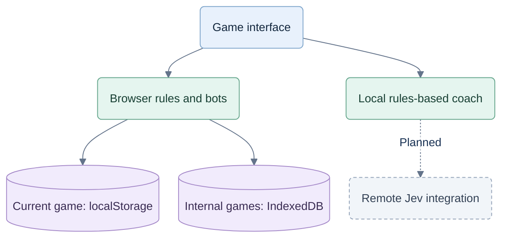

# Tricks Coach web prototype

A playable UX build for a card-game coach. The table comes first; help stays optional.

The owner selected **Tricks Coach** and **trickscoach.com** on 26 September 2026. Manual Vercel domain setup is planned for that date and remains unverified. This documentation update does not rename app UI, package identifiers or storage. See the [brand and domain decision](../planning/brand-and-domain.md).

## Run

```powershell
cd C:\repos\test-jev\web
npm install
npm run dev
```

Open `http://localhost:5173`. On an iPad or phone connected to the same Wi-Fi, use the Network address printed by Vite. Windows may require allowing local-network access. This is a development preview, not a hosted service.

```powershell
npm run build
npm test
```

Node 24 can also run tests without subprocesses: `node --test --test-isolation=none tests/*.test.ts`.

## Included

- Hearts solo, Spades solo and Spades partnerships: complete hands, scoring, successive hands and match outcomes.
- Passing and bidding with confirmation. Double-click/tap prepares a card off-turn and plays it on your turn; prepared cards never auto-play. Space selects and Enter plays for keyboard use.
- Three optional help levels: cue, context, suggestion. Coach preferences: when asked, occasional contextual nudges, after the hand.
- Public card counts, revealed voids and last-trick recall. No player-facing game archive.
- Hand recap with score and actual help usage; no invented accuracy, skill rating or mistake labels.
- Pause, automatic pause in background/portrait, current-game recovery, keyboard dialogs and reduced motion.
- Persistent game speed in Settings: 1×, 1.2× or 1.4×. Faster settings shorten bot/trick waits, not coach reading time.

## Screen behavior

iPad supports both orientations. Viewports under 700 CSS pixels wide that are taller than wide show a landscape gate; the game pauses until rotated. The app never rotates the page with CSS or assumes iOS will allow an orientation lock.

Landscape phones reserve the full screen width for the hand. Cards retain at least 44 pixels of exposed horizontal tap area at the tested 667-pixel minimum width. Insets protect notches and home indicators; visual viewport sizing follows browser chrome. Shorter screens can scroll the coach explanation while keeping its action available.

Support targets 2020-or-newer phones running maintained browsers. Physical iOS/Android device validation remains necessary; emulator viewport checks are not hardware certification.

## Current boundary

The games and local rules-based coach work without an API key. Jev, probability sampling and strategy evaluation are not connected yet. Recommendation quality, adaptive progress assessment and mistake categorization remain separate work; the UI does not pretend they are established.

The current game is saved in localStorage. Every started game's latest state and event trail are retained in this browser's IndexedDB for internal inspection, without an archive view. This is local prototype persistence, not central collection or cross-device sync. Clearing browser data removes it. Hidden cards are held locally for bot simulation, but coach input logic only uses the human hand and public plays.

## Prototype boundary

This describes the local prototype. The commercial server boundary is specified separately and remains to be implemented.



Code: `src/game.ts` rules, `src/coach.ts` advice, `src/storage.ts` persistence, `src/App.tsx` views, `src/styles.css` responsive design. Existing v0.2 files outside this folder remain reference material.

See [V1 setup](../planning/05-v1-setup.md) for the next decision-pipeline work and [UI verification](qa/UI-V1.md) for the text, gesture and speed update.
