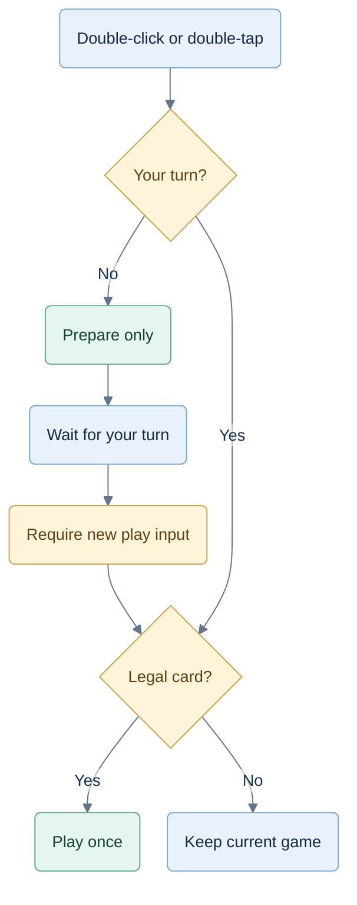

# UI update — 26 September 2026

Removed decorative table captions, idle coach prose, hand footer and recap pep talk. The table is wider and taller; functional scores, turn information and coaching remain.

Double-click/tap prepares a card off-turn and plays it on-turn. Preparation never auto-plays; illegal prepared cards clear when the turn arrives. Bid/pass confirmation remains. Space selects, Enter plays, and assistive button activation can play a legal card. Settings persist 1× / 1.2× / 1.4× speed.

## Card gesture behavior

Recorded prototype behavior; this diagram adds no hardware or assistive-technology validation claim.

## Verification

- 38 rule/coach/storage tests pass, including legacy saves and supported/invalid speed values. Production TypeScript/Vite build passes.
- Chromium: completed one full hand per mode using double-click for all 13 human plays. Seed 73: Hearts points 4/5/2/15; solo Spades −30/32/−30/42; partnerships −60/73/−60/73.
- Off-turn preparation survived bot turns and waited on the human turn without auto-playing. Double-click then played once. Three-card passing still required confirmation.
- Touch emulation: first tap selected, second tap played exactly one card. Keyboard Space selected, Enter played; a semantic assistive click played once.
- Controlled browser clock verified bot/trick waits: 900/2100 ms at 1×; 750/1750 at 1.2×; approximately 643/1500 at 1.4×. Pause prevented advancement; resume used a fresh delay.
- Speed survived reload. On 667×375, all speed controls and Done fit without scrolling. Card targets expose 44 CSS pixels; no page overflow. Phone portrait shows the rotation gate. iPad 768×1024 fits without overflow.
- At 1280×800, the table region grew from approximately 910×412 to 942×438 CSS pixels.

Checks used isolated browser contexts and legal seeded fixtures. Actual iPhone/iPad/Android hardware and VoiceOver/TalkBack were not tested; semantic activation and touch were emulated. Engine strategy, bidding weights and Jev integration were unchanged.

Screenshots: [desktop](ui-v1-desktop.png), [phone coach](ui-v1-phone.png), [phone settings](ui-v1-settings-phone.png), [iPad](ui-v1-ipad.png).
