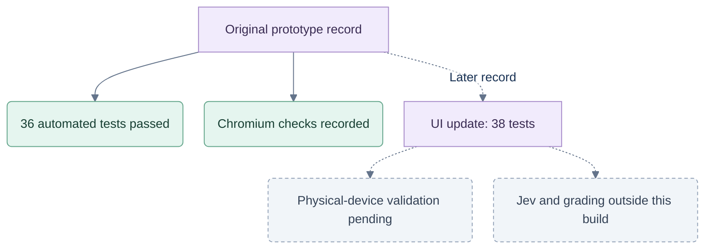

# Verification — 26 September 2026

The checks below describe the original prototype. The later [UI update](UI-V1.md) records the current card gestures, speed controls, 38-test result and replacement screenshots.

## Verification scope

Recorded prototype evidence only. Dashed branches identify a separate later record or work not validated by these checks.

## Automated checks

- 36 passing rule, coaching and persistence tests.
- Engine coverage includes 90 seeded complete hands and 12 partnership scoring cases.
- Checks cover legality, follow-suit exceptions, passing, moon scoring, Nil, bags, match ties, hidden-hand independence, factual memory and corrupt-save recovery.
- Production TypeScript/Vite build passes.

## Browser checks

Chromium, using the actual interface:

| Check | Result |
|---|---|
| Complete Hearts hand | 13 tricks; points 11 / 0 / 2 / 13 |
| Complete solo Spades hand | 13 human plays; no partner label; separate scores |
| Complete partnership hand | 13 human plays; mirrored team scores 61 / 60; scores carried to hand 2 |
| Optional assistance | Hint and table-note use recorded; 2 helped decisions, including 1 suggestion, in solo test |
| Passing | Selection can be reversed; exactly three received cards marked |
| Pause and portrait gate | No bot events advance while paused or rotated upright |
| Reload | Active game, hand and coach preference restored |
| Nil contract regression | Partner took 1 failed-Nil trick; a 4-trick unmet contract still displays 4 needed |
| Dialog focus | Selecting coach mode retains focus; background inert during dialogs and recap |
| Match result | Winning team named and comparative final scores shown |
| Internal retention | Multiple started games retained in IndexedDB; no archive navigation |

No horizontal/body overflow at 1440×900, 1024×768, 768×1024, 896×414, 844×390, 667×375, 667×320 and 640×300. The coach action stays available on short screens; explanations may scroll within their area. At 667×375, all 13 card targets were individually checked at their exposed centers. Portrait 375×667 correctly displays only the rotate screen.

No browser console errors or warnings in the checked session. Screenshots in this directory include the table, phone coach, game picker, portrait gate and match recap; `desktop-final.png` and `phone-final.png` show the finished table layout.

## Still requires device validation

Physical iPhone/iPad Safari and Android Chrome: touch comfort, actual notch/home-indicator insets, browser chrome changes, background suspension and storage eviction. Viewport emulation does not validate those hardware/browser behaviors. Live Jev, server persistence, calibrated move quality and progress assessment are outside this UX build.
